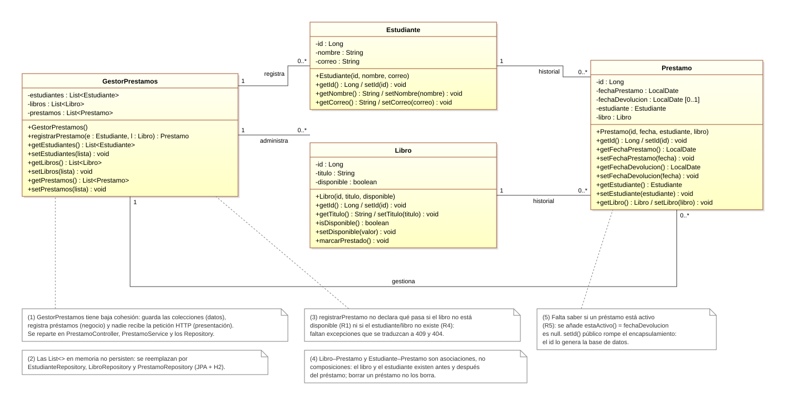
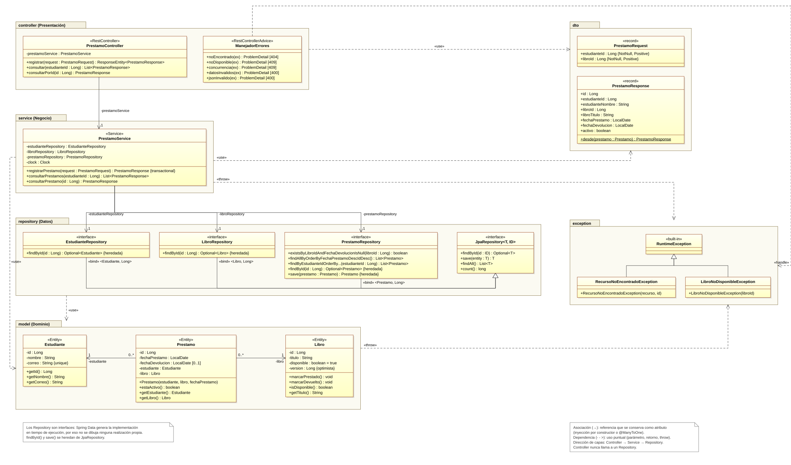
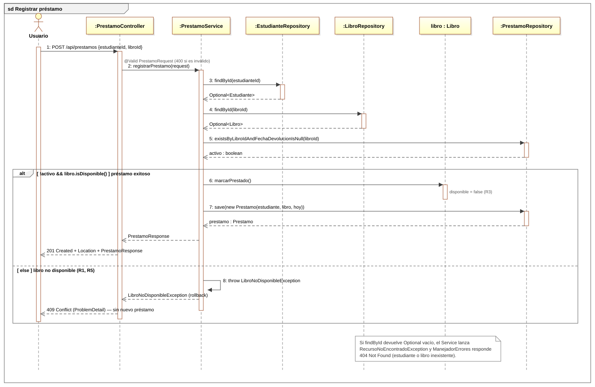

# SmartLibrary: del modelo de clases a una API REST por capas

Taller práctico del Bloque 7 de Diseño de Software (4.º semestre). Se rediseña el modelo inicial de SmartLibrary en tres capas (**Controller → Service → Repository**) y se implementa el caso de uso **«Registrar préstamo»** con Spring Boot.

**Tecnologías:** Java 21 · Spring Boot 3.5 · Maven · Spring Web · Spring Data JPA · Validation · H2

## Entregables

| # | Entregable | Dónde está |
|---|---|---|
| 1 | Diagrama inicial anotado con observaciones | [Actividad 1](#actividad-1--leer-y-cuestionar-el-modelo) |
| 2 | Tabla de responsabilidades | [Actividad 2](#actividad-2--asignar-responsabilidades) |
| 3 | Diagrama de clases por capas | [Actividad 3](#actividad-3--modelo-por-capas) |
| 4 | Diagrama de secuencia del préstamo | [Actividad 4](#actividad-4--secuencia-de-post-apiprestamos) |
| 5 | Proyecto Spring Boot y evidencias de pruebas | [`src/`](src) · [Actividad 6](#actividad-6--pruebas) · [evidencias](docs/evidencias-pruebas.md) |
| 6 | Explicación de las decisiones de diseño | [docs/decisiones-diseno.md](docs/decisiones-diseno.md) |

Reglas del caso: **R1** solo se presta un libro disponible · **R2** el préstamo registra estudiante, libro y fecha · **R3** al prestarse, el libro deja de estar disponible · **R4** una solicitud inválida no crea préstamo · **R5** un libro tiene varios préstamos históricos pero solo uno activo.

---

## Actividad 1 · Leer y cuestionar el modelo



**Datos y operaciones propios del dominio.** Los atributos de `Estudiante` (id, nombre, correo), `Libro` (id, título, disponible) y `Prestamo` (fechas, estudiante, libro), junto con `Libro.marcarPrestado()`. En cambio, `GestorPrestamos` mezcla dominio con almacenamiento: sus `List<>` son, en realidad, responsabilidad de acceso a datos.

**¿Por qué Libro–Prestamo y Estudiante–Prestamo son asociaciones y no composiciones?** Porque no hay relación todo-parte con ciclo de vida compartido. El libro y el estudiante existen antes del préstamo y siguen existiendo después. Un libro acumula muchos préstamos a lo largo del tiempo (1 a 0..*), y borrar un préstamo no debe borrar ni el libro ni el estudiante.

**Operaciones necesarias para consultar, validar y guardar:**
- buscar un estudiante por id y buscar un libro por id;
- saber si un libro está disponible y si tiene un préstamo activo;
- marcar el libro como prestado;
- crear el préstamo con la fecha actual;
- guardar el préstamo;
- listar los préstamos.

**Responsabilidades que faltan:**
- **Para recibir HTTP:** una clase que reciba `POST /api/prestamos`, valide el JSON y devuelva 201, 404, 409 o 400 (`PrestamoController` y `ManejadorErrores`).
- **Para acceder a datos:** interfaces que persistan y consulten en la base de datos (`EstudianteRepository`, `LibroRepository` y `PrestamoRepository`) en lugar de listas en memoria.

## Actividad 2 · Asignar responsabilidades

| Operación o decisión | Clase responsable | Justificación |
|---|---|---|
| Recibir `POST /api/prestamos` | `PrestamoController.registrar()` | Capa de presentación: traduce la petición HTTP y valida el formato (`@Valid PrestamoRequest`). No contiene reglas de negocio. |
| Buscar estudiante por identificador | `EstudianteRepository.findById()` (invocado por `PrestamoService`) | El acceso a datos es del Repository; el Service decide qué buscar y qué hacer si no existe (404). |
| Buscar libro por identificador | `LibroRepository.findById()` (invocado por `PrestamoService`) | Igual que el anterior: el Repository consulta y el Service coordina. |
| Validar disponibilidad | `Libro.marcarPrestado()` + `PrestamoService` (con `PrestamoRepository.existsByLibroIdAndFechaDevolucionIsNull`) | Regla de negocio (R1, R5). El libro conoce su estado (Experto en información) y el Service comprueba que no haya otro préstamo activo. |
| Crear el préstamo | `PrestamoService` (`new Prestamo(estudiante, libro, hoy)`) | GRASP Creador: el Service tiene los datos de inicialización (estudiante, libro y fecha) y coordina el caso de uso. |
| Cambiar disponibilidad | `Libro.marcarPrestado()` | La entidad modifica su propio estado (R3); nadie más asigna `disponible` desde fuera. |
| Guardar cambios | `PrestamoRepository.save()` dentro de la transacción de `PrestamoService` | Persistencia en el Repository; `@Transactional` garantiza que libro y préstamo se guardan juntos o no se guarda nada. |
| Devolver respuesta HTTP | `PrestamoController` (201 + `Location`) y `ManejadorErrores` (404, 409, 400) | La presentación decide los códigos HTTP; el Service solo lanza excepciones del dominio. |

## Actividad 3 · Modelo por capas



- **Presentación (`controller`):** `PrestamoController` y `ManejadorErrores`.
- **Negocio (`service`):** `PrestamoService`.
- **Datos (`repository`):** las interfaces `EstudianteRepository`, `LibroRepository` y `PrestamoRepository`, que heredan de `JpaRepository`.
- **Modelo de dominio (`model`):** `Estudiante`, `Libro` y `Prestamo`. Es el modelo que usan las tres capas, no una cuarta capa.
- **Apoyo:** `dto` (`PrestamoRequest`, `PrestamoResponse`) y `exception`.
- **Relaciones:**
  - Asociaciones dirigidas con multiplicidad para las referencias que se conservan como atributo (inyección y `@ManyToOne`).
  - Dependencias `«use»`, `«throw»` y `«handle»` para el uso puntual.
  - Generalización entre las interfaces de repositorio y `JpaRepository`.
  - No hay ninguna línea de Controller a Repository.

## Actividad 4 · Secuencia de POST /api/prestamos



El fragmento `alt` muestra los dos caminos que pide el taller: el **préstamo exitoso** (201) y el **libro no disponible** (409, con *rollback*). Los caminos de 404 se indican en la nota. Cada mensaje corresponde a una operación del diagrama de clases.

## Actividad 5 · Estructura del proyecto

```text
src/main/java/com/smartlibrary/
├── controller/   PrestamoController, ManejadorErrores
├── service/      PrestamoService
├── repository/   EstudianteRepository, LibroRepository, PrestamoRepository
├── model/        Estudiante, Libro, Prestamo
├── dto/          PrestamoRequest, PrestamoResponse
├── exception/    RecursoNoEncontradoException, LibroNoDisponibleException
└── config/       ClockConfig
src/main/resources/  application.properties, data.sql (datos iniciales)
```

### Ejecutar

```bash
./mvnw spring-boot:run
```

La API queda en `http://localhost:8080/api/prestamos` y la consola de H2 en `http://localhost:8080/h2-console` (JDBC URL `jdbc:h2:mem:smartlibrary`, usuario `sa`).

| Método | Ruta | Respuesta |
|---|---|---|
| `POST` | `/api/prestamos` con `{"estudianteId": 1, "libroId": 1}` | 201, 400, 404 o 409 |
| `GET` | `/api/prestamos` (opcional `?estudianteId=1`) | 200 con la lista |
| `GET` | `/api/prestamos/{id}` | 200 o 404 |

**Datos iniciales:** 3 estudiantes y 4 libros. El libro 3 tiene un préstamo activo y el libro 4 tiene un préstamo histórico ya devuelto.

## Actividad 6 · Pruebas

```bash
./mvnw test
```

Resultado: **11 pruebas, 0 fallos.** Hay 8 de integración (`PrestamoControllerTest`, a través de HTTP → Service → H2) y 3 unitarias (`LibroTest`). Las evidencias de las peticiones reales con `curl` están en [docs/evidencias-pruebas.md](docs/evidencias-pruebas.md).

| Escenario | Resultado esperado | Obtenido | Prueba |
|---|---|---|---|
| Préstamo de libro disponible | 201 Created y préstamo registrado | 201, `Location`, libro queda no disponible | `prestamoExitoso` |
| Libro ya prestado | 409 Conflict; sin nuevo préstamo | 409, el número de préstamos no cambia | `libroYaPrestado`, `segundoPrestamoDelMismoLibro` |
| Estudiante inexistente | 404 Not Found | 404, el libro sigue disponible | `estudianteInexistente` |
| Libro inexistente | 404 Not Found | 404 | `libroInexistente` |
| Consulta de préstamos | 200 OK con registros | 200 con la lista de préstamos | `consultaDePrestamos`, `consultaFiltrada` |
| Solicitud inválida (R4) | 400 Bad Request; sin préstamo | 400 | `solicitudInvalida` |

### Trazabilidad requisito → clase → operación → prueba

| Regla | Clase | Operación | Prueba |
|---|---|---|---|
| R1 | `Libro`, `PrestamoService` | `marcarPrestado()`, `registrarPrestamo()` | `libroYaPrestado`, `unLibroPrestadoNoSePuedeVolverAPrestar` |
| R2 | `Prestamo` | `Prestamo(estudiante, libro, fechaPrestamo)` | `prestamoExitoso` |
| R3 | `Libro` | `marcarPrestado()` | `prestamoExitoso`, `unLibroDisponibleSePrestaYDejaDeEstarDisponible` |
| R4 | `PrestamoRequest`, `ManejadorErrores`, `@Transactional` | `datosInvalidos()`, `registrarPrestamo()` | `solicitudInvalida`, `estudianteInexistente` |
| R5 | `PrestamoRepository`, `Prestamo` | `existsByLibroIdAndFechaDevolucionIsNull()`, `estaActivo()` | `segundoPrestamoDelMismoLibro`, `consultaDePrestamos` |

## Actividad 7 · Revisión y defensa

**¿Qué responsabilidades cambiaron del modelo inicial al modelo por capas?** `GestorPrestamos` desaparece y su trabajo se reparte en tres partes:
- Las listas pasan a los tres **Repository**, que persisten en una base de datos real.
- `registrarPrestamo` pasa a **PrestamoService**, ahora con validaciones, excepciones y transacción.
- La entrada y salida HTTP, que antes no existía, la asume **PrestamoController**, junto con **ManejadorErrores** para los códigos de error.

Además, `Prestamo` gana `estaActivo()`, y los `setId()` públicos se eliminan porque el id lo genera la base de datos.

**¿Qué patrón GRASP se reconoce en la coordinación del caso de uso?** El **Controlador** (*Controller*): `PrestamoService` recibe la operación del sistema «registrar préstamo» y coordina a los demás objetos sin hacer él mismo el trabajo de cada uno. También aparecen el **Experto en información** (`Libro` decide sobre su disponibilidad), el **Creador** (el Service crea el `Prestamo` porque tiene los datos para inicializarlo), **Bajo acoplamiento** (el Controller no conoce los Repository) y **Alta cohesión**.

**¿Por qué un controlador GRASP no equivale necesariamente a `@RestController`?** El Controlador GRASP es un rol de diseño: el primer objeto, después de la interfaz de usuario, que recibe y coordina una operación del sistema. `@RestController` es una anotación técnica de Spring para la capa web. Si pusiéramos la coordinación en el `@RestController`, este quedaría atado a HTTP y no se podría reutilizar desde otra interfaz (consola, mensajería, pruebas). Por eso, en este diseño, el Controlador GRASP es `PrestamoService`, y `PrestamoController` es solo un adaptador HTTP.

**¿Dónde se ubica la regla de disponibilidad y por qué?** En la entidad `Libro` (`marcarPrestado()` lanza `LibroNoDisponibleException`), porque el libro es quien conoce su estado. El Service la complementa comprobando en el Repository que no exista otro préstamo activo (R5). Ni el Controller ni el Repository deciden reglas de negocio.

**¿Qué relaciones UML se conservaron y cuáles se modificaron?**
- **Se conservan:** las asociaciones `Prestamo → Estudiante` y `Prestamo → Libro` con multiplicidad 0..* a 1. Se vuelven navegables desde `Prestamo` (`@ManyToOne`).
- **Se eliminan:** las tres asociaciones de `GestorPrestamos` (registra, administra, gestiona).
- **Se añaden:**
  - Asociaciones dirigidas Controller → Service → Repository.
  - Generalización de los repositorios hacia `JpaRepository`.
  - Dependencias de uso puntual hacia los DTO y las excepciones.
- **Sin cambios:** sigue sin haber composición ni agregación.

**¿Cómo se comprueba la trazabilidad requisito → clase → operación → prueba?** Con la tabla de la Actividad 6, y comprobando que cada mensaje del diagrama de secuencia existe como operación en el diagrama de clases y en el código. Cada fila termina en una prueba automática que se ejecuta con `./mvnw test`.

---

Los diagramas son SVG en estilo Visual Paradigm y se generan con los scripts de [`docs/fuentes`](docs/fuentes), por ejemplo `python d2_modelo_capas.py ../diagramas/02-modelo-por-capas.svg`.
